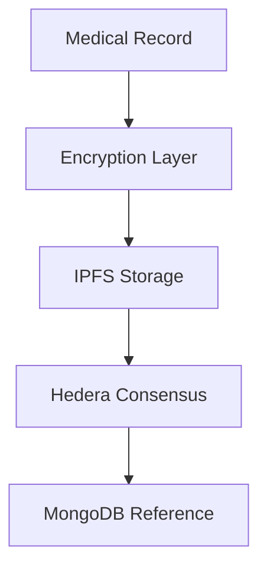

# ✍ StepWise - Support. Include. Guide.


**StepWise is a project made up of three applications designed to provide all the necessary care for children with Down syndrome, using advanced technologies such as IoT robotics, AI agents, automation, websockets and blockchain. The applications offer fully adapted solutions developed in consultation with Down syndrome associations and their experts.**

---

# 📑 Table of Contents

* **[Full logique description](#full-logique-description)**
  * [Step wise](#-step-wise-)
  * [Robot wise](#robot-wise)
  * [Care wise](#care-wise)

* **[Full technical description](#full-technical-description)**
    * [Get Started](#get-started)
    * [1.Backend-nestjs](#1-backend-nestjs)
    * [2.blockchain](#2-blockchain)
    * [3.agents](#3-agents)
    * [4.jetracer](#4-jetracer)
    * [5.carewise/stepwise/robotwise](#5-carewisestepwiserobotwise)

---

# Full logique description


<details>
<summary><h2> Step wise </h2></summary>

Enabling children with Down syndrome to acquire essential skills for their daily, social, and professional lives through an interactive, personalized, and accessible platform.


<details>
<summary><b>✅ Features Done</b></summary>

* **Spelling**: Learning correct pronunciation through voice recognition.
* **Studies**: Simplified modules in Mathematics, Physics, Sciences.
* **Adapted sports**: Simple and accessible physical activities.
* **Baking & Cooking**: Development of culinary autonomy for future vocations.
* **Social awareness**: Prevention against bullying, manipulation, and sexual education.
* **Daily routines**: Waking up, hygiene, dressing, breathing, balanced meals.
* **Badges & Levels**: Reward system motivating task completion.
* **🧠 Artificial Intelligence (AI)**

  * Integration with **WebRTC** via LiveKit to capture and process voice continuously.
  * Live image processing from camera feed.
  * **Breathing detection** and validation of relaxation exercises.
  * **Audio generation** via **Speechify** for natural voice interaction.

</details>

<details>
<summary><b>🎯 Typical Use Case</b></summary>

* 🛌 Child opens StepWise app for morning routine.
* 🔔 Tasks validated in real-time with AI agent.
* 📚 Access to educational activities (spelling, math, sciences).
* 🧁 End the day with cooking or adapted sports.
* 🏅 Each validated task grants badges and levels.

</details>

</details>

<details>
<summary><h2>Robot wise</h2></summary>

**RobotWise** allows children to interact with a physical robot (**JetRacer**) through a tablet.


<details>
<summary><b>✅ Features Done</b></summary>

* 🤖 Real-time robot control
* 🛡️ Environment safety monitoring
* 🎨 Drawing activity validated with AI
* 📖 AI-generated storytelling
* 🧭 Explore mode
* 📊 Progress synchronization with StepWise

</details>

<details>
<summary><b>🎯 Typical Use Case</b></summary>

* 📱 Launch RobotWise on tablet.
* 🛡️ Explore safely with robot sensors.
* 🎨 Draw and validate in real-time.
* 📖 AI stories narrated via TTS.
* 📊 Sync results with StepWise.

</details>

</details>

<details>
<summary><h2>Care wise</h2></summary>

**CareWise** is a mobile app for parents and admins to track and support child development.


<details>
<summary><b>✅ Features Done</b></summary>

* 📊 Child progress dashboard
* 📰 Interactive social wall
* 🤖 Personalized job suggestions via n8n
* 👨‍🏫 Expert network recommendations
* 📅 Personalized schedules & reminders
* 🔐 Secure authentication & role management

</details>

<details>
<summary>🎯 Typical Use Case</summary>

* 📱 Parent opens CareWise app.
* 📊 Track progress and badges.
* 📰 Engage with social wall.
* 🤖 Receive personalized guidance.
* 📅 Manage schedules & routines.
* 🔐 Secure access for roles.

</details>

</details>

---

#  Full technical description

|                 | [Backend](#1-backend-nestjs)     | [Blockchain](#2-blockchain)                                | [Agents](#3-agents)                                           | [JetRacer](#4-jetracer)                                                                                                            | [CareWise](#5-carewisestepwiserobotwise) | [StepWise](#5-carewisestepwiserobotwise)               | [RobotWise](#5-carewisestepwiserobotwise)                      |
| --------------- | -------------------------------- | ---------------------------------------------------------- | ------------------------------------------------------------- | ---------------------------------------------------------------------------------------------------------------------------------- | ---------------------------------------- | ------------------------------------------------------ | -------------------------------------------------------------- |
| **Tool**        | [NestJS](https://nestjs.com/)    | [Hedera](https://hedera.com/) + [IPFS](https://ipfs.tech/) | [LiveKit](https://livekit.io/) + [Python](https://python.org) | [JetRacer AI Kit](https://www.waveshare.com/wiki/JetRacer_AI_Kit) + [Jetson](https://developer.nvidia.com/embedded/jetson-modules) | [FlutterFlow](https://flutterflow.io/)   | [FlutterFlow](https://flutterflow.io/)                 | [FlutterFlow](https://flutterflow.io/)                         |
| **Requirement** | [Requirements](#11-requirements) | [Requirements](#21-requirements)                           | [Requirements](#31-requirements)                              | [Requirements](#41-requirements)                                                                                                   | [Requirements](#51-requirements)         | [Requirements](#51-requirements)                       | [Requirements](#51-requirements)                               |
| **Instruction** | [Instructions](#12-instructions) | [Instructions](#22-instructions)                           | [Instructions](#32-instructions)                              | [Instructions](#42-instructions)                                                                                                   | [Instructions](#52-instructions)         | [Instructions](#52-instructions)                       | [Instructions](#52-instructions)                               |
| **Achievement** | Auth, WS, Docker, Multi-lang     | Decentralized storage, NFT certificates                    | Real-time AV interaction, AI pipeline                         | Robot control & sensor safety, AI drawing validation                                                                               | Automation, scraping web                 | WebSocket in FlutterFlow, realtime LiveKit integration | Real-time drawing + LiveKit integration, WebSocket, Stream API |


---

## Get Started

Clone repository:

```bash
git clone https://github.com/lujakob/nestjs-realworld-example-app.git
```
## 1 Backend-nestjs

### 1.1 Requirements

* Node.js (>=18)
* npm (>=9) or yarn
* NestJS CLI
* MongoDB

Example `.env` file:

```env
JWT_SECRET=secret_key
MONGO_URL=mongodb+srv://...
LIVEKIT_API_KEY=...
LIVEKIT_API_SECRET=...
LIVEKIT_URL=wss://...
```

### 1.2 Instructions

```bash
cd backend-nestjs
npm install
npm start
# API at http://localhost:3000
```


## 2 blockchain

### 2.1 About
A secure, decentralized healthcare records management system built on Hedera Hashgraph with an integrated NFT-based achievement system. The platform ensures HIPAA-compliant storage and sharing of medical records while incentivizing medical education through verifiable NFT badges.

#### 🌟 Key Features

#### Healthcare Records Management 

- **End-to-End Encryption**: AES-256-GCM encryption for all sensitive medical data
- **Decentralized Storage**: IPFS integration for distributed content storage
- **Blockchain Verification**: Hedera Consensus Service (HCS) for immutable audit trails
- **HIPAA Compliance**: Secure data handling with patient consent management

#### NFT Badge System

- **Verifiable Credentials**: NFT-based certification for achievements
- **Token Standards**: Custom HTS (Hedera Token Service) implementation
- **Achievement Tracking**: Course completion and certification verification

#### 🔐 Security Architecture

#### Data Protection


#### Security Features
- AES-256-GCM encryption for PHI (Protected Health Information)
- Cryptographic patient identification
- Zero-knowledge storage architecture
- Immutable audit trails via HCS
- Secure key management system

#### 🛠️ Technical Stack

- **Blockchain**: Hedera Hashgraph
  - Consensus Service (HCS)
  - Token Service (HTS)
  
- **Backend**:
  - Node.js & Express
  - MongoDB Atlas
  - IPFS via Pinata
  
- **Security**:
  - AES-256-GCM encryption
  - ED25519 key pairs

### 2.2 Instructions


#### 📖 API Documentation:

#### Health Records API

```typescript
POST /api/health-records/submit
{
  "patientId": "patient@email.com",
  "content": {
    "diagnosis": "...",
    "treatment": "...",
    "medications": [...]
  },
  "metadata": {
    "provider": "Dr. Smith",
    "facility": "General Hospital"
  }
}
```

#### Badge System API

```typescript
POST /api/badges/mint
{
  "userEmail": "medical.professional@hospital.com",
  "courseId": "course_mongodb_id",
  "metadata": {
    "name": "Advanced Cardiac Care",
    "description": "Completed advanced cardiac care certification"
  }
}
```

#### 🔧 Installation & Setup

```bash
# Clone repository
git clone https://github.com/yourusername/hedera-healthcare
cd hedera-healthcare

# Install dependencies
npm install

# Configure environment
cp .env.example .env
# Edit .env with your credentials

# Start server
npm run dev
```


## 3 agents
### 3.1 Requirements

-   Python 3.9+
-   pip
-   LiveKit Cloud/self-hosted server
    

Example of .env file:

```json
LIVEKIT_API_KEY="***************"
LIVEKIT_API_SECRET="**************************************"
LIVEKIT_URL="wss://**********.livekit.cloud"

GOOGLE_API_KEY="*****************************"
DEEPSEEK_API_KEY="***********************"
DEEPGRAM_API_KEY="********************"

```


### 3.2 Instructions

Create a virtual environment:
   ```sh
   python -m venv .venv
   ```
Activate the virtual environment:
   - On macOS and Linux:
     ```sh
     source .venv/bin/activate
     ```
   - On Windows:
     ```sh
     .venv\Scripts\activate
     ```
Install dependencies:
   ```sh
   pip install -r requirements.txt
   ```
Run the agent in development mode:
   ```sh
   python main.py dev
   ```


## 4 jetracer

### 4.1 Requirements


- [JetRacer AI Kit for Jetson](https://www.waveshare.com/wiki/JetRacer_AI_Kit)
- [DHT Sensor](https://www.waveshare.com/temperature-humidity-sensor.htm)
- [MQ-2 Gas Sensor](https://cothings.net/collections/capteurs-de-gaz-et-dalcool/products/mq-2-module-de-capteur-dhydrogene-au-butane-gpl-gaz-fumee)

---

#### **Install BIOS & Jetson OS**
1. Download the [Jetson ROS image](https://drive.google.com/file/d/16OBLRNlrZaSkhVcC4xJ6VugtChmZw1_B/view)
2. Flash it using SD card and BalenaEtcher

---

#### **Setup Python Virtual Environment**

```bash
pip install virtualenv
python3 -m virtualenv -p python3 env --system-site-packages
```
### 4.2 Instructions


-   BIOS install
    
-   DonkeyCar setup
    
-   Docker configuration
    
-   Run Jetson worker
    

```bash
docker run --privileged --net=host -it ahmeddouss/jetson_worker_image
python3 jetracer_worker/main.py

```


## 5 carewise/stepwise/robotwise

### 5.1 Requirements
- [Flutter SDK](https://docs.flutter.dev/get-started/install) (latest stable version)  
- [Dart SDK](https://dart.dev/get-dart) (comes with Flutter)  
- [Android Studio](https://developer.android.com/studio) or [Visual Studio Code](https://code.visualstudio.com/) (with Flutter & Dart plugins)  
- Android Emulator / iOS Simulator / physical device  
- [Xcode](https://developer.apple.com/xcode/) (for iOS development, macOS only)  
- A device with internet connection  
### 5.2 Instructions

Switch to the repo folder:  
```bash
cd stepwise
```

*Install dependencies*:  
```bash
flutter pub get
```

*Run the app* on your connected device or emulator:  
   ```bash
   flutter run
   ```


</details>


